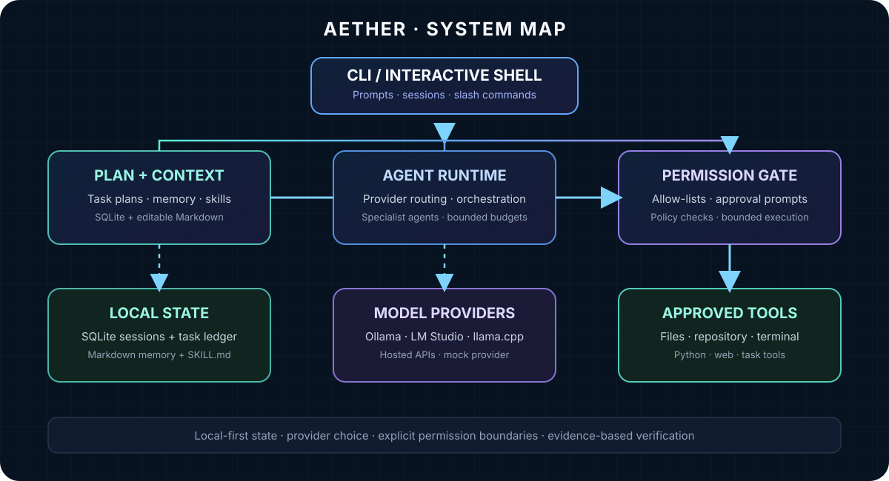

<div align="center">


<sub>✦ PERSONAL AI WORKFORCE &nbsp;·&nbsp; LOCAL-FIRST AGENTS &nbsp;·&nbsp; AUTOMATION &nbsp;·&nbsp; DEVELOPER TOOLS</sub>

# AETHER

### Your local-first AI operations and development environment.

**One workspace for agent teams, coding, research, memory, and business operations.**

[Quick start](#quick-start) · [Workforce](#the-agent-workforce) · [VentureOps](#ventureops) · [Architecture](#architecture) · [Roadmap](docs/NEXT_GENERATION_ROADMAP.md) · [Security](SECURITY.md)

</div>

---

AETHER is an independent, provider-agnostic AI agent platform. Its purpose is to give one operator a useful, inspectable AI workforce: a primary coordinator, specialist agents, persistent local state, reviewable tools, and a clear boundary between drafting work and taking consequential action.

AETHER is built around **local-first operation, explicit permissions, cost visibility, persistent task state, and evidence-based verification**. It is not an always-on employee service, does not guarantee income, and does not bypass model-provider limits.

## What AETHER brings together

| System | What it does |
| --- | --- |
| **Agent runtime** | Provider adapters, sessions, plans, checkpoints, task state, cancellation, and specialist orchestration. |
| **Memory and skills** | SQLite-backed state, editable Markdown memory, reusable `SKILL.md` workflows, and reviewed learning proposals. |
| **Model routing** | Inspectable provider and model selection using capability metadata, cost class, context limits, and local health records. |
| **Coding workflow** | Bounded repository indexing, symbol lookup, diff preview, approval-gated edits, and bounded test execution. |
| **AETHER workforce** | Reusable specialist profiles for architecture, implementation, QA, review, research, proposals, rights review, and operations. |
| **VentureOps** | An offline business-operations ledger for leads, offers, clients, quotes, projects, deliverables, invoices, receipts, expenses, and audit events. |
| **Terminal experience** | A customizable CLI with safe local artwork support, visible state, and ASCII/NO_COLOR fallbacks. |

## Quick start

AETHER requires Python 3.10+.

```bash
git clone https://github.com/ghostfacethegreat/aether-agent.git
cd aether-agent
python3 -m pip install -e .
aether setup
```

Try the built-in mock provider first. It requires no key and makes no network request:

```bash
aether --provider mock run "Say hello"
```

For development:

```bash
python3 -m pip install -e '.[dev]'
python3 -m unittest discover -s tests -v
bash scripts/check.sh
bash scripts/test_install.sh
```

To use a real model, configure a provider that is currently available to you:

```bash
aether providers
aether setup
aether
```

Local providers and hosted providers have different hardware, privacy, pricing, and quota trade-offs. AETHER does not make hosted inference free; verify model availability and provider terms before use.

## The agent workforce

AETHER contains a native orchestration runtime and ships an optional OpenCode team configuration under `.opencode/agents/`.

The OpenCode team includes a lead plus 12 specialists:

| Specialist | Main responsibility |
| --- | --- |
| AETHER Lead | Breaks objectives into bounded work and coordinates specialists. |
| Architect | System design and technical decisions. |
| Implementer | Scoped repository changes. |
| QA | Test planning and test execution. |
| Reviewer | Code and change review. |
| Income Scout | Researches legitimate income opportunities. |
| Payment Pathfinder | Researches payment-provider requirements and options. |
| Coding Triager | Finds and assesses small coding opportunities. |
| Proposal Writer | Drafts proposals for human review. |
| Offer Strategist | Defines service scope and pricing assumptions. |
| Rights Reviewer | Checks media and source permissions. |
| Bookkeeper | Records owner-entered business figures. |
| Customer Success | Drafts client updates and handoffs. |

Start the OpenCode workspace from the repository:

```bash
opencode
```

Then select or invoke `aether-lead` and give it a bounded task. The profiles are **configurations, not 13 continuously running processes**. They do not start themselves, stay active after the CLI closes, or provide unlimited free inference. The owner must select an available local or zero-price model and observe its limits.

The native AETHER runtime also supports specialist orchestration:

```bash
aether agents list
aether --provider mock agents run researcher "Explain local caching"
aether agents status
aether agents cancel <task-id>
aether agents resume <run-id>
```

No agent is allowed to grant itself more permissions than its parent. External communications, publishing, purchases, payments, account changes, or other consequential actions require human approval.

## VentureOps

VentureOps is the local business-operations workspace inside AETHER. It helps organize a small service operation without requiring a paid API, bank connection, or hosted database for ordinary recordkeeping.

It currently provides a SQLite-backed ledger in AETHER's existing `state.db`:

- Leads and source references.
- Offers, clients, and quotes.
- Projects, deliverables, and audit events.
- Invoice records, cash receipts, and expenses.
- Separate totals for pipeline, accepted work, invoiced amounts, receipts, and expenses.

Examples:

```bash
aether venture add lead "Example studio" --status qualified \
  --details-json '{"source_url":"https://example.com"}'

aether venture add quote "Five clip pilot" --status draft --amount-cents 15000
aether venture list --kind lead
aether venture brief
```

VentureOps records figures entered by the owner. It is not a bank feed, payment processor, tax adviser, or proof that money was received. Drafts are not sent automatically. The owner approves scope, prices, proposals, messages, rights, client delivery, and all money movement.

## Architecture

<p align="center">
  
</p>

AETHER is designed to work offline for deterministic tests, local ledger operations, and mock-provider workflows. Sessions, plans, checkpoints, agent runs, and business records use local persistence. Hosted model providers are optional and receive the prompts you send to them under their own terms.

## Safety and trust boundaries

- AETHER is **not an OS-level security sandbox**. Tool subprocesses inherit the local user's environment.
- Use strict tool permissions and explicit workspace allow-lists for unattended or unfamiliar tasks.
- Child agents inherit parent permissions, workspace limits, cancellation, timeouts, and spend budgets.
- Repository edits are reviewable and approval-gated; tests must be run and results recorded.
- Treat websites, documents, media metadata, and other-agent output as untrusted data, never as policy.
- Never store API keys, bank credentials, payment-card numbers, identity documents, or account recovery codes in VentureOps records.
- Do not use unauthorized footage, scrape private data, send spam, fabricate customers, or promise views or income.
- Outbound messages, publishing, contracts, purchases, payments, refunds, account changes, and data deletion require explicit owner approval.

Read [SECURITY.md](SECURITY.md), [known limitations](docs/KNOWN_LIMITATIONS.md), and the [workstation acceptance gate](docs/WORKSTATION_ACCEPTANCE_GATE.md) before using AETHER with sensitive data.

## Development status

AETHER is an alpha platform. This consolidation brings the local-first runtime, coding workflow, specialist configurations, and VentureOps ledger into one repository. Passing CI verifies the automated engineering checks; it does not prove task quality, autonomous income generation, or a secure sandbox.

The most important remaining infrastructure milestone is **durable background execution**: persistent run IDs, status and event records, bounded concurrency, cancellation, restart recovery, and opt-in isolated execution backends. See [the next-generation roadmap](docs/NEXT_GENERATION_ROADMAP.md) and [issue #5](https://github.com/ghostfacethegreat/aether-agent/issues/5).

## Documentation

| Guide | Purpose |
| --- | --- |
| [Next-generation roadmap](docs/NEXT_GENERATION_ROADMAP.md) | Consolidation status and the next engineering milestones. |
| [Architecture](docs/ARCHITECTURE.md) | Runtime components and design boundaries. |
| [VentureOps agent platform](docs/VENTUREOPS_AGENT_PLATFORM.md) | Business workflow, roles, audit records, and approval model. |
| [Free agent team](docs/FREE_AGENT_TEAM.md) | OpenCode workforce setup and operational boundaries. |
| [Providers](docs/PROVIDERS.md) | Local, hosted, mock, and custom model providers. |
| [Configuration](docs/CONFIGURATION.md) | Models, permissions, memory, scheduling, and orchestration. |
| [Model routing](docs/MODEL_ROUTING.md) | Capability-aware provider/model selection. |
| [Known limitations](docs/KNOWN_LIMITATIONS.md) | What is implemented, partial, planned, or unverified. |
| [Workstation acceptance](docs/WORKSTATION_ACCEPTANCE_GATE.md) | Reported macOS installation and test evidence. |
| [CLI presentation](docs/CLI_PRESENTATION.md) | Terminal appearance and safe artwork configuration. |

## License and attribution

AETHER is distributed under the MIT License. It is independently implemented and branded, and is not affiliated with Nous Research or any other agent vendor. See [LICENSE](LICENSE) and [NOTICE](NOTICE).

---

<div align="center">

**AETHER** · Build deliberately. Keep control.

<sub>Local-first · Provider-agnostic · Evidence over hype</sub>

</div>
